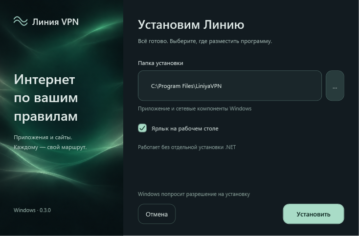

# Линия VPN для Windows

Приложения и сайты — по вашим правилам.

Начальный набор: ChatGPT (сайт), YouTube, Telegram (приложение), Gemini и Speedtest. Остальные соединения по умолчанию идут напрямую.

**[Скачать установщик для Windows x64](https://github.com/nkorolev12/vpn-releases/releases/latest/download/LiniyaVPN-Setup.exe)**

Установите приложение, добавьте сервер по приглашению владельца либо через свой `.conf` и выберите приложения и сайты для VPN. Для YouTube и ChatGPT есть готовые наборы. Остальные соединения используют выбранный вами режим.

Требования: Windows 10 2004 или новее / Windows 11, Intel или AMD x64. Отдельные .NET, WireGuard и AmneziaVPN не нужны. Права администратора требуются при установке и обновлении.

Обновления появляются в настройках приложения. Пакеты проверяются цифровой подписью; личные правила и оформление сохраняются. Для удаления используйте список установленных приложений Windows.

Этот репозиторий содержит только публичные дистрибутивы и описание обновлений. Личные профили, рабочие конфигурации и ключи сюда не публикуются. Исходный проект хранится отдельно.

`LiniyaVPN-Setup.exe` — файл для обычной установки. Остальные файлы релиза предназначены для автоматического обновления и проверки контрольных сумм.

Собственный EXE пока не подписан коммерческим сертификатом издателя Windows. Подпись обновлений проверяет само приложение; подписанный драйвер WinDivert поставляется без изменений. Открытые компоненты и их лицензии перечислены в `THIRD-PARTY.md` внутри установленной программы.
